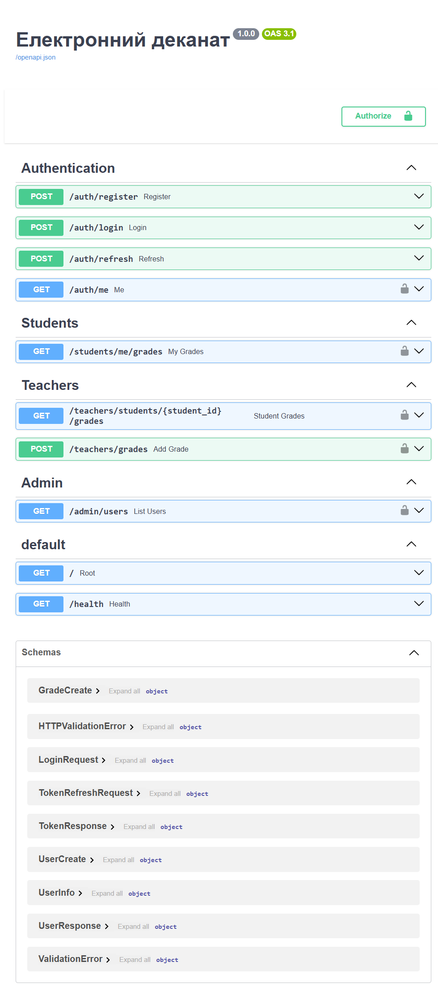
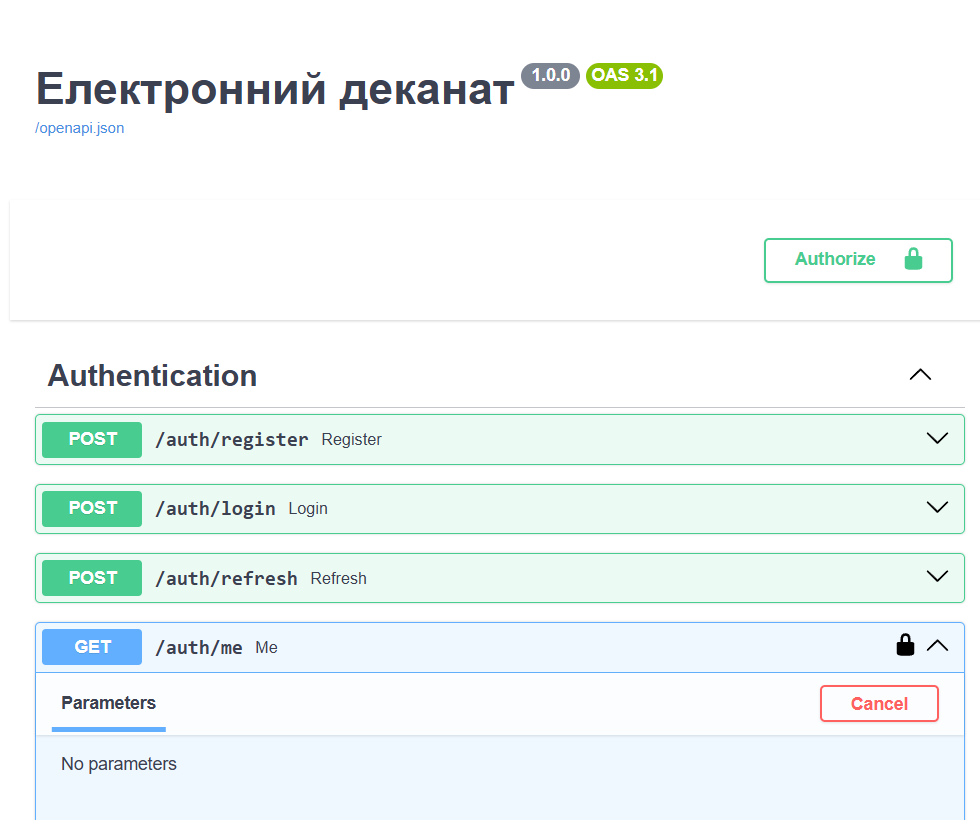
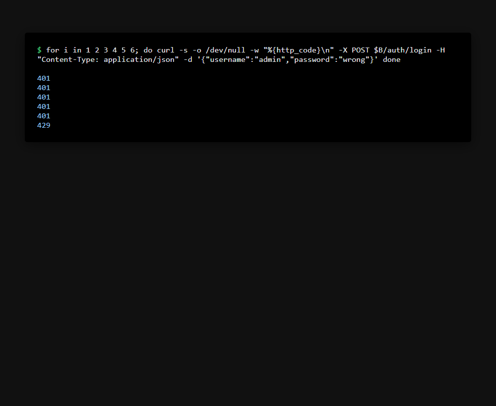

# Захищений REST API «Електронний деканат»

Практична робота №1 з дисципліни «Безпека інформаційних систем»

**Студент:** ojevilya  
**Група:** КН-31  
**Курс:** 3 курс, Комп'ютерні науки

## Опис

Захищений REST API для системи «Електронний деканат», реалізований на **FastAPI** з чотирма шарами захисту (Defense in Depth):

- Ізольоване контейнерне середовище (Docker Compose)
- Модель контролю доступу **RBAC** у базі даних (SQLite + SQLAlchemy + Alembic)
- Безпечне зберігання паролів (хешування **bcrypt** з автоматичною сіллю)
- Токенна автентифікація та авторизація (**JWT access/refresh**)
- Захист веб-рівня: **Security Headers**, **CORS** (allow-list), **Rate Limiting** (slowapi), **санітизація** проти Stored XSS (bleach)

## Технологічний стек

- Python 3.11, FastAPI 0.111.0, Uvicorn 0.29.0
- SQLAlchemy 2.0.30, Alembic 1.13.1, SQLite
- Pydantic 2.7.4, passlib + bcrypt 4.0.1
- python-jose[cryptography] 3.3.0, bleach 6.1.0, slowapi 0.1.9
- Docker, Docker Compose

## Структура проєкту

`
information-security-practice/
├── app/
│   ├── __init__.py
│   ├── main.py                # точка входу, middleware, роутери
│   ├── config.py              # конфігурація (JWT, CORS, секрети)
│   ├── database.py            # engine, Base, SessionLocal, get_db
│   ├── models.py              # 5 + 2 зв'язкові таблиці RBAC + предметні
│   ├── schemas.py             # Pydantic-схеми, валідація, санітизація
│   ├── security.py            # bcrypt hash/verify
│   ├── seed.py                # початкове наповнення БД
│   ├── auth/
│   │   ├── __init__.py
│   │   ├── jwt_handler.py     # створення/перевірка JWT
│   │   ├── dependencies.py    # get_current_user, require_role
│   │   └── router.py          # /auth/register, /login, /refresh, /me
│   ├── routes/
│   │   ├── __init__.py
│   │   ├── students.py        # /students/me/grades
│   │   ├── teachers.py        # /teachers/...
│   │   └── admin.py           # /admin/users
│   ├── middleware/
│   │   ├── __init__.py
│   │   ├── security_headers.py
│   │   └── rate_limiter.py
│   └── validators/
│       ├── __init__.py
│       └── sanitizer.py       # санітизація bleach
├── alembic/                   # міграції БД
│   ├── env.py
│   ├── script.py.mako
│   └── versions/
│       └── f5ac69464028_create_all_tables.py
├── alembic.ini
├── docs/screenshots/           # скріншоти для звіту
├── requirements.txt
├── Dockerfile
├── docker-compose.yml
├── .env.example
└── .gitignore
`

## Запуск проєкту

### Клонування репозиторію
`ash
git clone https://github.com/YOUR_USERNAME/information-security-practice.git
cd information-security-practice
`

### Налаштування змінних оточення
Створіть файл .env на основі .env.example:
`ash
cp .env.example .env
`

Згенеруйте випадковий секретний ключ (64 hex-символи) та замініть у .env:
`ash
openssl rand -hex 32
`

### Запуск з Docker Compose

`ash
docker compose up -d --build
`

### Застосування міграцій та наповнення БД

`ash
docker compose exec api alembic upgrade head
docker compose exec api python -m app.seed
`

API буде доступне за адресою: **http://localhost:8000**  
Swagger UI: **http://localhost:8000/docs**  
ReDoc: **http://localhost:8000/redoc**

## Тестові облікові записи

Паролі вказані у pp/seed.py (не зберігаються у відкритому вигляді в БД).

| Логін | Пароль | Роль |
|---|---|---|
| dmin | Admin123!@# | admin |
| 	eacher01 | Teacher123! | teacher |
| student01 | Student123! | student |

## Ендпоінти та ролі доступу

| Ендпоінт | Метод | Доступ | Опис |
|---|---|---|---|
| / | GET | **Public** | Кореневий маршрут |
| /health | GET | **Public** | Перевірка стану API (таблиці БД) |
| /auth/register | POST | **Public** | Реєстрація (автопризначення ролі student) |
| /auth/login | POST | **Public** | Вхід → повертає access + refresh токени |
| /auth/refresh | POST | **Public** | Оновлення токенів (потрібен 
efresh token) |
| /auth/me | GET | **Аутентифікований** (Bearer access) | Інформація про поточного користувача |
| /students/me/grades | GET | **student** | Перегляд лише власних оцінок |
| /teachers/students/{student_id}/grades | GET | **teacher, admin** | Перегляд оцінок студента |
| /teachers/grades | POST | **teacher, admin** | Додавання оцінки (з фіксацією ssigned_by) |
| /admin/users | GET | **admin** | Список всіх користувачів |

## Матриця RBAC

| Дозвіл | admin | teacher | student |
|---|---|---|---|
| 
ead_grades | ✓ | ✓ | ✓ |
| edit_grades | ✓ | ✓ | — |
| 
ead_schedule | ✓ | ✓ | ✓ |
| manage_users, manage_groups, manage_subjects | ✓ | — | — |
| iew_reports | ✓ | ✓ | — |

## Фінальна перевірка (розділ 10)

| № | Сценарій | Запит | Очікування | Фактичний результат |
|---|---|---|---|---|
| 1 | Health | GET /health | 200, 	ables: 8 | 200, {"status":"healthy","database":"SQLite","tables":8} |
| 2 | Реєстрація (успіх) | POST /auth/register (валідні дані) | 201, без password_hash | 201, без password_hash, роль student, bcrypt $2b$ |
| 3 | Дублікат username | POST /auth/register (той самий username) | 409 | 409 {"detail":"Username вже зайнятий"} |
| 4 | Слабкий пароль | POST /auth/register (password:"password") | 422 | 422 (валідація великої літери/цифри/малої літери) |
| 5 | XSS в імені | POST /auth/register (ull_name зі <script>) | 422 | 422 (allow-list, лише літери/пробіл/апостроф/дефіс) |
| 6 | Логін (успіх) | POST /auth/login (admin/Admin123!@#) | 200, ccess_token + 
efresh_token | 200, пара токенів JWT (HS256) |
| 7 | Невірний пароль | POST /auth/login (admin/wrong) | 401 «Невірний логін або пароль» | 401 з однаковим повідомленням (захист від Username Enumeration) |
| 8 | Без токена | GET /auth/me | 401 | 401 {"detail":"Потрібна автентифікація"} |
| 9 | Підроблений токен | GET /auth/me (Bearer bc.def.ghi) | 401 | 401 {"detail":"Невалідний або протермінований токен"} |
| 10 | Refresh замість access | GET /auth/me (Bearer refresh token) | 401 | 401 {"detail":"Потрібен access token"} |
| 11 | Оновлення токенів | POST /auth/refresh (refresh token) | 200, нова пара токенів | 200 (ротація refresh/access) |
| 12 | Свої оцінки | GET /students/me/grades (student01) | 200 | 200, grade: 92 (student_id береться з токена) |
| 13 | Студент → admin | GET /admin/users (student01) | 403 | 403 (ролі беруться з БД, перевірка ролей) |
| 14 | Викладач → admin | GET /admin/users (teacher01) | 403 | 403 |
| 15 | Адмін → admin | GET /admin/users (admin) | 200, список користувачів | 200, список усіх користувачів |
| 16 | Оцінка поза діапазоном | POST /teachers/grades (grade: 9999) | 422 | 422 (діапазон 0–100) |
| 17 | Stored XSS у коментарі | POST /teachers/grades (comment зі <script>) | 201, тег вирізано | 201, comment: "alert(document.cookie)Добре" (bleach tags=[], strip=True) |
| 18 | Security Headers | GET /health | CSP, X-Frame-Options, nosniff, HSTS, Referrer-Policy | ✓ (default-src 'none', X-Frame-Options DENY, nosniff, HSTS, Referrer-Policy, Cache-Control no-store) |
| 19 | CORS чужий домен | OPTIONS /auth/login (Origin: http://evil.example) | 400, без ccess-control-allow-origin | 400, без ACAO (allow-list доменів) |
| 20 | Rate Limiting | 6× POST /auth/login (невірний пароль) | 401×5, потім 429 | 401×5, 429 (5 запитів/хв на IP) |

## STRIDE-таблиця

| Загроза (STRIDE) | Контрзахід у коді | Що можна покращити |
|---|---|---|
| **S (Spoofing)** — підробка автентифікації | JWT з підписом HS256 (python-jose, перевірка algorithms=[ALGORITHM]), bcrypt-хешування паролів, перевірка типу токена (ccess vs 
efresh), однакове повідомлення про невірний логін/пароль (Username Enumeration) | RS256/ES256 з окремим ключем підпису, MFA, rotation ключів |
| **T (Tampering)** — підробка даних/токенів | Перевірка підпису JWT (erify_token), server-side валідація Pydantic (allow-list, діапазони 0–100), санітизація HTML (bleach) перед збереженням в БД (Stored XSS) | Цифрові підписи критичних операцій, аудит-лог змін |
| **R (Repudiation)** — заперечення дій | Поле ssigned_by у Grade (FK на User, хто виставив оцінку), ролі в БД, access/refresh токени | Audit trail (who/when/what IP), immutable лог у БД |
| **I (Information Disclosure)** — витік інформації | UserResponse не повертає password_hash, однакові повідомлення про помилки, CORS allow-list (без *), Security Headers (CSP, no-store), токени не містять паролів | Rate limiting на всі чутливі ендпоінти, маскування логів, HTTPS-only |
| **D (DoS)** — відмова в обслуговуванні | Rate Limiting (slowapi): /auth/login 5/хв, /auth/register 10/хв за IP, обмеження довжин полів Pydantic | Redis для distributed rate limiting, черги, IP-blocklists |
| **E (Elevation of Privilege)** — підвищення привілеїв | RBAC у БД (Role → Permissions), 
equire_role() перевіряє ролі з БД (не з токена) → відкликання ролі діє одразу, принцип мінімальних привілеїв, розділення 401 (не автентифіковано) і 403 (не авторизовано) | ABAC (атрибути), регулярна ревізія прав доступу, токен blacklist при logout |

## Скриншоти

_01. Swagger UI з усіма групами ендпоінтів (Authentication, Students, Teachers, Admin)_

_02. Swagger після Authorize: успішний GET /auth/me (200)_

_03. Студент виконує GET /admin/users → 403 (недостатньо прав)_

_04. Цикл логінів з невірним паролем: останні коди 429 (Rate Limiting)_

_05. Заголовки безпеки у відповіді /health (CSP, X-Frame-Options, nosniff, HSTS, Referrer-Policy)_

## Коміти по етапах

`ash
6c15c64 stage1: FastAPI + Docker Compose environment
36aa49d stage2: models, RBAC, alembic migration, seed
e9c4acf stage3: register/login with bcrypt and validation
44a34ad stage4: JWT access/refresh, protected routes, RBAC
9c297cd stage5: security headers, CORS, rate limiting, XSS sanitization
`

## Перевірка запуску з чистого клону

Проєкт протестовано: docker compose down -v && docker compose up -d --build && alembic upgrade head && python -m app.seed працює без помилок. Всі перевірки з розділу 10 пройдено успішно.

## Висновок

Реалізовано 4 незалежні шари захисту (Defense in Depth): ізольоване середовище та секрети поза кодом, bcrypt-хешування паролів, JWT + RBAC з розділенням 401/403, та захист веб-рівня (Headers, CORS, Rate Limiting, санітизація). Збій одного шару компенсується іншими.
